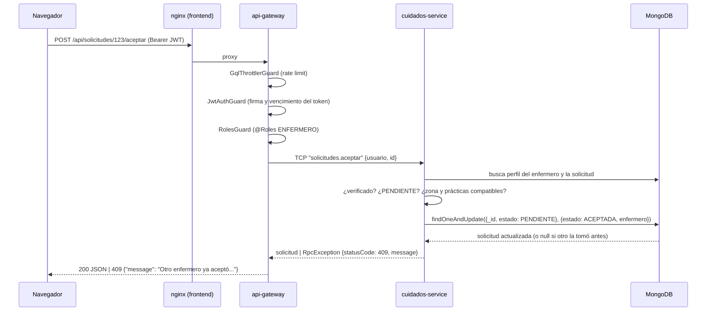

# Arquitectura de Cuidá+

Guía técnica para entender el código: cómo viaja un pedido, dónde está cada cosa y por qué.

## 1. Estructura del repositorio

```
/
├── backend/                         Monorepo NestJS (un package.json, tres aplicaciones)
│   ├── apps/
│   │   ├── api-gateway/             HTTP: REST + Swagger + GraphQL
│   │   │   ├── src/
│   │   │   │   ├── common/          guards (JWT, roles, rate limit), decoradores, logging, clientes TCP
│   │   │   │   ├── auth/            POST /auth/registro, /auth/login, GET /auth/perfil
│   │   │   │   ├── usuarios/        GET /usuarios (búsqueda de pacientes)
│   │   │   │   ├── zonas/           GET/POST /zonas
│   │   │   │   ├── enfermeros/      perfil, búsqueda, verificación, reseñas
│   │   │   │   ├── practicas/       ★ CRUD GraphQL #1 (resolver + tipos)
│   │   │   │   ├── solicitudes/     ★ CRUD GraphQL #2 + acciones REST del flujo
│   │   │   │   ├── estadisticas/    GET /estadisticas/cobertura, GET /health
│   │   │   │   ├── app.module.ts    registro de guards, GraphQL, throttler
│   │   │   │   ├── configurar-app.ts helmet, CORS, ValidationPipe, Swagger
│   │   │   │   └── main.ts
│   │   │   └── test/                tests e2e (levantan todo el sistema en memoria)
│   │   ├── auth-service/            Microservicio TCP: usuarios + JWT
│   │   │   └── src/{usuarios,auth}/
│   │   └── cuidados-service/        Microservicio TCP: el dominio
│   │       └── src/{practicas,zonas,enfermeros,solicitudes,estadisticas}/
│   ├── libs/common/                 Código compartido: patrones TCP, enums, errores, helpers de Mongo
│   ├── scripts/seed.js              Inicialización de la base con datos de demo
│   └── Dockerfile                   Una imagen para los tres servicios
├── frontend/                        React + Vite + Tailwind
│   ├── src/
│   │   ├── api/                     cliente HTTP/GraphQL y funciones por recurso
│   │   ├── auth/                    sesión (contexto), RutaProtegida
│   │   ├── components/ui/           componentes reutilizables (Tabla, Modal, Campos, Boton, ...)
│   │   ├── components/...           componentes de dominio (TarjetaSolicitud, FormularioSolicitud, ...)
│   │   ├── pages/{paciente,enfermero,admin}/
│   │   └── hooks/, utils/
│   ├── nginx.conf                   sirve la SPA y hace proxy a /api y /graphql
│   └── Dockerfile
├── docs/                            esta documentación
└── docker-compose.yml
```

## 2. Recorrido de un pedido (ejemplo: un enfermero acepta una solicitud)



Puntos clave:

- El **gateway no tiene lógica de negocio**: autentica, autoriza por rol, valida el formato y reenvía.
- El **microservicio decide** (estados, permisos sobre el recurso, compatibilidad) y responde con un error
  de negocio que trae el código HTTP (`RpcErrors.conflict(...)` → 409).
- `common/microservicios.ts` en el gateway convierte ese error en el `HttpException` correspondiente y
  maneja timeouts (504) y servicios caídos (503).

## 3. Autenticación y autorización

1. `POST /api/auth/login` → `auth-service` compara el hash con **bcrypt** y firma un **JWT**
   (`sub`, `email`, `rol`, `nombre`, `apellido`; vence en 8 h).
2. El frontend guarda el token y lo manda en `Authorization: Bearer ...`.
3. En el gateway, tres **guards globales** se aplican a REST y a GraphQL por igual:
   - `GqlThrottlerGuard`: 120 req/min por IP (login: 10/min).
   - `JwtAuthGuard`: todo es privado salvo lo marcado con `@Public()`.
   - `RolesGuard`: respeta `@Roles(Rol.ADMIN, ...)`.
4. El decorador `@UsuarioActual()` arma `{id, rol, nombre, apellido}` y se envía a los microservicios
   para que validen permisos **sobre el recurso** (ej.: un paciente solo ve *sus* solicitudes).

En el frontend, `RutaProtegida` impide entrar a `/app/*` sin sesión y redirige según el rol. Si el
backend responde 401 (token vencido), el cliente cierra la sesión.

## 4. REST vs. GraphQL

| Recurso | GraphQL (CRUD) | REST |
|---|---|---|
| Práctica | `practicas`, `practica`, `crearPractica`, `actualizarPractica`, `eliminarPractica` | — |
| Solicitud | `solicitudes(filtro)`, `solicitud`, `crearSolicitud`, `actualizarSolicitud`, `eliminarSolicitud` | `POST /solicitudes/:id/aceptar · cancelar · finalizar · visitas · resena`, `GET /solicitudes/:id/visitas` |
| Auth | — | `POST /auth/registro`, `POST /auth/login`, `GET /auth/perfil` |
| Usuarios | — | `GET /usuarios?rol&q` (ADMIN) |
| Zonas | — | `GET /zonas`, `POST /zonas` (ADMIN) |
| Enfermeros | — | `GET /enfermeros?zonaId&practicaId&q&verificado`, `GET/PUT /enfermeros/mi-perfil`, `GET /enfermeros/:id`, `GET /enfermeros/:id/resenas`, `PATCH /enfermeros/:id/verificacion` (ADMIN) |
| Estadísticas | — | `GET /estadisticas/cobertura` (ADMIN), `GET /health` |

Criterio: **el CRUD de las entidades va por GraphQL** (el cliente pide exactamente los campos que
necesita, incluidas las relaciones). **Las acciones que cambian el estado** de un flujo son verbos
REST explícitos y quedan documentados en Swagger.

### Ejemplos GraphQL

```graphql
# Listar mis solicitudes con sus relaciones
query {
  solicitudes(filtro: { estado: PENDIENTE }) {
    id estado direccion fechaInicio
    zona { nombre departamento }
    practicas { nombre }
    enfermero { nombre apellido matricula }
  }
}

# Crear una práctica (ADMIN)
mutation {
  crearPractica(input: { nombre: "Nebulización", duracionEstimadaMin: 20 }) { id nombre activa }
}
```

En el explorador (`/graphql`) agregar el header `Authorization: Bearer <token>` (se obtiene con el login en Swagger).

## 5. Reglas de negocio importantes (cuidados-service)

| Regla | Dónde |
|---|---|
| Máquina de estados (`PENDIENTE → ACEPTADA → EN_CURSO → FINALIZADA`, o `CANCELADA`) | `libs/common/src/enums.ts` + `solicitudes.service.ts → asegurarTransicion` |
| Un enfermero solo ve/acepta solicitudes de **sus zonas** cuyas prácticas estén **todas** entre las suyas | `solicitudes.service.ts → listar (vista disponibles)` y `esCompatible` |
| Solo enfermeros **verificados** pueden aceptar | `solicitudes.service.ts → aceptar` |
| Aceptación **atómica** (dos enfermeros a la vez → solo uno gana) | `findOneAndUpdate({estado: PENDIENTE})` |
| La primera visita pasa la solicitud a `EN_CURSO`; solo se registran prácticas del plan | `visitas.service.ts` |
| Una reseña por solicitud, solo del paciente y solo si está `FINALIZADA`; recalcula el promedio | `resenas.service.ts` |
| Si el enfermero cambia la matrícula, pierde la verificación | `enfermeros.service.ts → guardarPerfil` |
| No se borra una práctica en uso (se desactiva) | `practicas.service.ts → eliminar` |
| Cobertura: CRÍTICA (demanda sin enfermeros), BAJA (> 3 solicitudes abiertas por enfermero) | `estadisticas.service.ts` |

## 6. Manejo de errores y logging

- **Validación de entrada** (gateway): `class-validator` en DTOs REST e inputs GraphQL; `whitelist` +
  `forbidNonWhitelisted` rechazan campos extra. Mensajes en español.
- **Validación de datos** (microservicios): esquemas Mongoose con mensajes propios; los errores se
  convierten en 400 (`convertirErrorValidacion`) y las claves duplicadas en 409.
- **Errores GraphQL**: `formatearErrorGraphQL` devuelve `{ message, extensions: { code, status } }`.
- **Logs**: `LoggingInterceptor` (gateway) y `RpcLoggingInterceptor` (microservicios), por ejemplo:

```
[HTTP] POST /api/solicitudes/66f.../aceptar [ENFERMERO enfermera@cuidamas.com] +18ms
[RPC]  solicitudes.aceptar OK +12ms
[HTTP] GraphQL crearPractica -> 403 +2ms
```

## 7. Docker

| Contenedor | Imagen | Puerto en la PC |
|---|---|---|
| `mongo` | `mongo:8.0` (volumen `mongo-data`) | `127.0.0.1:27030` |
| `seed` | backend · `node scripts/seed.js` (corre una vez y termina) | — |
| `auth-service` | backend · `dist/apps/auth-service/main.js` | — (solo red interna) |
| `cuidados-service` | backend · `dist/apps/cuidados-service/main.js` | — (solo red interna) |
| `api-gateway` | backend · `dist/apps/api-gateway/main.js` | `3100` |
| `frontend` | nginx con la SPA compilada | `5180` |

Orden de arranque (con `depends_on` + healthchecks): mongo saludable → seed termina → microservicios →
gateway saludable → frontend.
