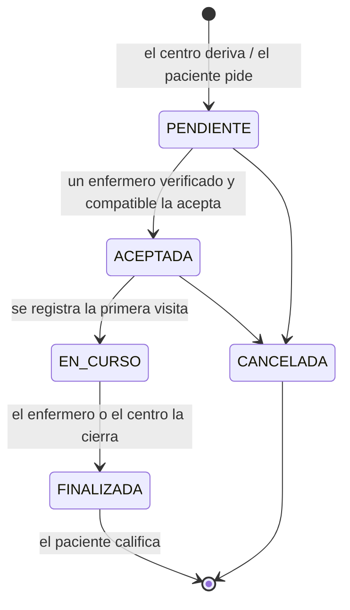
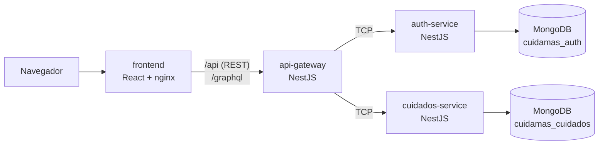
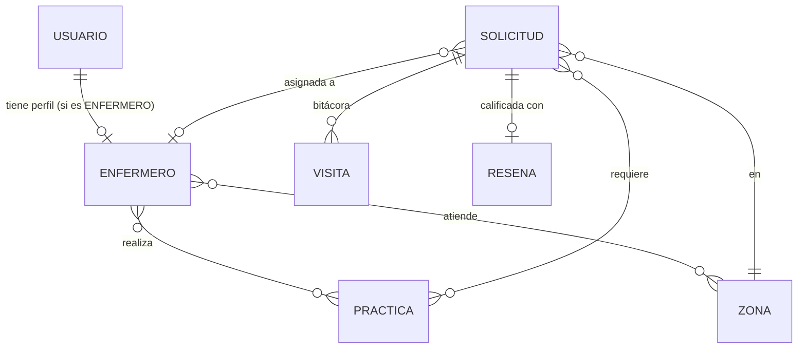

# Cuidá+ — Documento de la problemática, la solución y la arquitectura

**Trabajo Práctico Integrador — Programación III (IES 9-023) — 2026**

## 1. Problemática

Cuando un paciente recibe el **alta** de un hospital o de un centro de atención primaria, muchas veces el
tratamiento **continúa en su domicilio**: curación de una herida quirúrgica, aplicación de inyectables,
control de presión o de glucemia, cambio de sonda, cuidado de úlceras por presión en personas postradas.

Hoy ese tramo del cuidado tiene tres problemas:

1. **Falta de continuidad.** El centro que dio el alta pierde contacto con el paciente. No sabe si la
   herida evoluciona bien ni si las indicaciones se cumplen. La información queda en papeles sueltos o en
   el WhatsApp del enfermero.
2. **Falta de garantías.** La familia consigue un enfermero "de boca en boca". No hay forma simple de saber
   si está matriculado, si realiza esa práctica o si atiende en esa zona.
3. **Desigualdad territorial.** Hay zonas (sobre todo departamentos alejados) con mucha demanda y pocos
   enfermeros. Esa brecha no se mide, así que no se puede planificar.

Esto afecta a los tres actores que menciona la consigna: **pacientes**, **personal de enfermería** y
**centros de atención sanitaria de la región**.

## 2. Solución propuesta

**Cuidá+** es una aplicación web que organiza la **enfermería domiciliaria después del alta**:

| Necesidad | Cómo la resuelve Cuidá+ |
|---|---|
| Continuidad | El centro de salud **deriva** al paciente con un **plan de cuidados** (prácticas, frecuencia, fechas, domicilio). Cada visita queda en una **bitácora** que ven el paciente, su familia y el centro. |
| Garantías | Solo los enfermeros con **matrícula verificada** por el centro pueden tomar solicitudes, y solo las de **sus zonas** y con **prácticas que realizan**. Al terminar, el paciente **califica** la atención. |
| Desigualdad territorial | Un tablero de **cobertura por zona** compara la demanda (solicitudes abiertas) con la oferta (enfermeros verificados) y marca las zonas **críticas**. |

El paciente o un familiar también puede pedir cuidados por su cuenta (solicitud *particular*), sin
derivación.

### Ciclo de vida de una solicitud

## 3. Organización de los microservicios

| Servicio | Responsabilidad | Expone |
|---|---|---|
| **api-gateway** | Única puerta de entrada. Valida el JWT y el rol, valida los datos de entrada, limita peticiones, documenta la API y traduce cada pedido HTTP/GraphQL a un mensaje TCP. | REST (`/api`), Swagger (`/api/docs`), GraphQL (`/graphql`) |
| **auth-service** | Identidad: registro de usuarios, contraseñas hasheadas (bcrypt), login y emisión del JWT, búsqueda de usuarios. | Mensajes TCP `auth.*` y `usuarios.*` |
| **cuidados-service** | Dominio: catálogo de prácticas, zonas, perfiles de enfermeros (relaciones M:N con prácticas y zonas), solicitudes y su máquina de estados, bitácora de visitas, reseñas y estadísticas de cobertura. | Mensajes TCP `practicas.*`, `zonas.*`, `enfermeros.*`, `solicitudes.*`, `visitas.*`, `resenas.*`, `estadisticas.*` |

Cada microservicio tiene **su propia base de datos** y no conoce al otro. Cuando una operación necesita
datos de los dos (por ejemplo, el centro deriva a un paciente), el **gateway los combina**: valida al
paciente en `auth-service` y crea la solicitud en `cuidados-service`.

### Modelo de datos

- `USUARIO` vive en `cuidamas_auth`; el resto en `cuidamas_cuidados`.
- Las relaciones **muchos-a-muchos** se guardan como arrays de referencias (`ObjectId`) y se completan
  con `populate`.

## 4. Tecnologías

NestJS 11 · `@nestjs/microservices` (TCP) · GraphQL (Apollo, code-first) · Swagger · MongoDB 8 + Mongoose ·
JWT · React 19 + Vite + Tailwind CSS · React Router · Jest · Vitest + React Testing Library ·
Docker + docker-compose · nginx.
